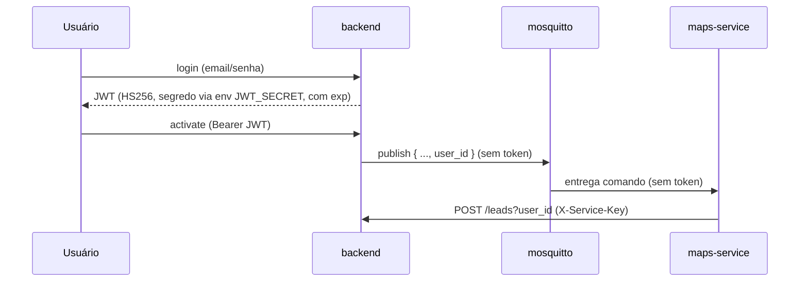

# Arquitetura do Projeto — Prospect Clients

> Documento de referência da arquitetura atual e base para discutir melhorias de
> segurança. Reflete o código no momento da redação; ao alterar fluxos de
> autenticação/mensageria, atualize este arquivo.

## 1. Visão geral

A aplicação coleta *leads* a partir de uma busca, por duas fontes: Google Maps
(negócios com telefone e endereço) e Instagram (perfis encontrados pelo índice do
Google). Sobre esses leads o usuário cria **campanhas**: envios em lote por
WhatsApp (leads com celular) ou Instagram (perfis), entregues aos poucos, em lotes
e em horário comercial. Cada mensagem é gravada no banco antes de sair, então nada
se perde se algum serviço cair (ver 4.5). É composta por seis serviços, um
gateway de WhatsApp e um broker MQTT, orquestrados por `docker-compose.yml`.

| Serviço | Stack | Porta (host) | Responsabilidade |
|---|---|---|---|
| `frontend` | Vue 3 + Vite + nginx | 80 | UI (login, prospecção, leads) |
| `backend` | FastAPI (Python 3.12) | 8000 | API REST, autenticação, persistência, orquestra o scraping via MQTT |
| `maps-service` | Python + Selenium/Firefox | — | Faz o scraping do Google Maps e grava leads na API |
| `instagram-service` | Python + nodriver/Chrome | — | Busca perfis do Instagram pelo índice do Google e grava leads na API |
| `whatsapp-sender` | Python | — | Envia as mensagens de WhatsApp das campanhas, uma por vez, no ritmo que o backend define |
| `waha` | WAHA Core (WhatsApp Web) | — | Gateway do WhatsApp; só o `whatsapp-sender` fala com ele |
| `instagram-dm` | Python + nodriver/Chrome | — | Envia as mensagens de Instagram (DM) das campanhas, com um Chrome logado na conta remetente |
| `mosquitto` | Eclipse Mosquitto (MQTT) | 11883 | Bus de comando backend → serviços de scraping |

## 2. Diagrama de componentes

```mermaid
flowchart LR
    User([Usuário / Browser])
    FE[frontend\nVue + nginx :80]
    BE[backend\nFastAPI :8000]
    MQTT{{mosquitto\nMQTT :1883}}
    MAPS[maps-service\nSelenium/Firefox]
    IG[instagram-service\nnodriver/Chrome]
    WS[whatsapp-sender]
    WAHA[waha\nWhatsApp Web]
    DM[instagram-dm\nnodriver/Chrome]
    DB[(SQLite test.db)]

    User -->|HTTP + JWT| FE
    FE -->|/api/backend/* JWT| BE
    BE --> DB
    BE -->|publish prospect/maps\nprospect/instagram\n(sem token, só user_id)| MQTT
    MQTT -->|subscribe prospect/maps| MAPS
    MQTT -->|subscribe prospect/instagram| IG
    MAPS -->|POST /leads?user_id, PATCH status\nX-Service-Key| BE
    IG -->|POST /leads?user_id, PATCH status\nX-Service-Key| BE
    WS -->|POST /outbox/whatsapp/claim\nresult, health\nX-Service-Key| BE
    WS -->|REST + X-Api-Key| WAHA
    DM -->|POST /outbox/instagram/claim\nresult, health\nX-Service-Key| BE
```

## 3. Serviços em detalhe

### 3.1 backend (FastAPI)
- **Camadas:** Controller → Service → Repository (SQLAlchemy). DI de services via
  `configurations/dependencies.py::service_provider`.
- **Domínios:** `users`, `operations`, `leads`, `automations`, `campaigns`.
- **Persistência:** SQLite (`configurations/database.py`, `sqlite:///./test.db`).
- **Endpoints principais:**
  - `POST /users/`, `POST /users/login`, `GET /users/userme`
  - `GET/POST /leads/`, `GET /leads/categories` (paginação + filtros server-side)
  - `GET/POST /operations/`, `PATCH /operations/{id}/status`
  - `POST /automations/operations/maps/activate`, `PUT /automations/operations/maps/deactivate`
  - `POST /automations/operations/instagram/activate`, `PUT /automations/operations/instagram/deactivate`
  - `POST /campaigns/preview`, `POST/GET /campaigns`, `GET /campaigns/{id}[/messages]`,
    `POST /campaigns/{id}/pause|resume|cancel`, `GET /channels`, `POST /channels/{c}/unpause`,
    `POST /channels/{c}/reconnect`, `POST /channels/{c}/verification-code`
  - `POST /leads/do-not-contact`
  - Só serviço (`X-Service-Key`): `POST /outbox/{channel}/claim`,
    `POST /outbox/messages/{id}/result`, `POST /outbox/{channel}/health`
- **Mensageria de saída:** `utils/publisher.py` publica no MQTT (tópicos `prospect/maps` e `prospect/instagram`).
- **Migrations:** o schema pertence ao **Alembic** (`back_end/migrations/`). A
  aplicação não cria nem altera tabela: o `alembic upgrade head` roda como passo
  separado antes do uvicorn (ver `back_end/Dockerfile`). `env.py` lê a URL de
  `configurations/database.py`, então há uma só fonte de verdade.
  - `0001_initial_schema` é o baseline do que o `create_all` criava.
  - `0002_add_operations_source` adiciona `operations.source`.
  - `0005_add_campaigns` cria `campaigns`, `outbound_messages`, `sender_channels`
    e `leads.nao_contatar`.
  - `0006` e `0007` dão a `sender_channels` os pedidos que vêm da tela: novo QR
    code / novo login, e o código de verificação do Instagram.
- **`operations.source`** ("maps" ou "instagram") diz ao front qual endpoint de
  deactivate chamar, para que parar uma operação continue funcionando depois de
  um reload.

### 3.2 maps-service (Selenium)
- **Entrada:** consome o tópico MQTT `prospect/maps` (`messaging/mqtt_handler.py`).
- **Execução:** cada operação roda em uma *thread* com um `stop_event`
  (`services/operation_service.py`); o scraping em si fica em `scraper/maps_scraper.py`.
- **Saída:**
  - grava leads chamando `POST /leads/` no backend (`services/lead_service.py`);
  - atualiza status via `PATCH /operations/{id}/status`.
  - Não envia mensagem nenhuma: o envio é feito por campanhas (4.5).
- **Estado:** operações ativas vivem **em memória** (`_active_operations`); reconciliadas
  no startup do backend (ver `OperationsService.reset_orphaned_operations`).

### 3.3 instagram-service (nodriver)
- **Entrada:** consome o tópico MQTT `prospect/instagram` (`src/main.py`).
- **Execução:** uma *thread* daemon por operação com `stop_event` (`src/operations.py`),
  e um event loop asyncio dentro dela, porque o nodriver é assíncrono. A busca em
  si fica em `src/search.py`, e o parse do HTML em `src/serp.py`.
- **Estratégia:** monta um dork `site:instagram.com <texto da busca>`, lê a página
  de resultados do Google com um Chrome real e extrai os handles. Nenhuma conta
  do Instagram é usada e nenhuma requisição vai para o Instagram.
- **Saída:** grava leads chamando `POST /leads/` (`nome` recebe `@handle`, que é
  único no Instagram e é a chave do upsert) e atualiza status via
  `PATCH /operations/{id}/status`.
- **Estado:** operações ativas vivem **em memória**, como no maps; reconciliadas
  no startup do backend por `OperationsService.reset_orphaned_operations`.

### 3.4 frontend (Vue)
- Pinia stores (`auth`, `leads`, `operations`, `campaigns`).
- Campanhas: criadas na tela de Leads (seleção ou "todos do filtro"), acompanhadas
  em `/campanhas` (status das contas, QR code, progresso, pausar/cancelar).
- Token JWT guardado em `localStorage`; injetado em toda request via interceptor
  (`services/backend.js`). nginx faz proxy de `/api/backend` → backend.

### 3.5 whatsapp-sender + waha
- **Sem estado.** Mensagens e ritmo ficam no banco do backend. O worker repete:
  checa a sessão no WAHA → `POST /outbox/whatsapp/claim` → envia → reporta o
  resultado. Derrubá-lo a qualquer momento não perde nada (4.5).
- **Envio** (`gateway.py`): confere se o número tem WhatsApp (`check-exists`, que
  também resolve o nono dígito), simula digitação e chama `sendText`. Fica atrás
  da interface `WhatsAppGateway`; trocar pela Cloud API oficial é escrever outro adapter.
- **Conexão do número:** enquanto a sessão pede QR code, o worker o envia em
  `POST /outbox/whatsapp/health` e a tela de Campanhas o mostra. A sessão fica no
  volume `waha-sessions`.
- O `waha` não publica porta: só o worker o alcança, pela rede do compose (S4).

### 3.6 instagram-dm
- **Por que navegador:** a API oficial do Instagram só deixa uma empresa responder
  quem escreveu primeiro. Abordar um lead é fazer o que uma pessoa faz: abrir o
  perfil, clicar em Mensagem, digitar e dar Enter, com um Chrome real (nodriver,
  com interface sob Xvfb, como a busca).
- **Mesmo contrato do WhatsApp:** sem estado, `claim` → envia → reporta. Um
  "Tente novamente mais tarde" vira `blocked`, e o backend pausa o canal por 24h.
- **Login:** usuário e senha da conta dedicada vêm do `.env` do compose, nunca do
  banco. Se o Instagram pedir código por e-mail/SMS, a tela de Campanhas mostra um
  campo; o código vai para `sender_channels` e o worker o pega no próximo report de
  saúde. O worker nunca repete um login sozinho: senha recusada ou código pendente
  esperam o usuário, porque logins repetidos são o que trava a conta.
- **Perfil de Chrome próprio** (volume `instagram-dm-profile`), separado do
  `instagram-service`: a busca não usa conta, e uma restrição nesta conta não pode
  atingi-la.
- As telas são reconhecidas pelo texto visível (`pages.py`), nunca pelo HTML, que
  traz todos os textos do app dentro dos scripts.

## 4. Fluxos principais

### 4.1 Login
1. `POST /users/login` valida senha (bcrypt) e emite JWT.
2. Front guarda o token e o envia como `Authorization: Bearer` nas próximas chamadas.

### 4.2 Iniciar operação de scraping
1. `POST /automations/operations/maps/activate` cria a operação (status=1) e
   **publica no MQTT** `{status, id_operation, search_text, user_id, message_user}`
   (sem token de usuário).
2. `maps-service` recebe, abre o Firefox, coleta leads.
3. Para cada lote: `POST /leads/?user_id=...` no backend (autenticado com
   `X-Service-Key`). O texto `message_user` fica só guardado na operação.

### 4.3 Iniciar busca no Instagram
1. `POST /automations/operations/instagram/activate` cria a operação
   (status=1, `source="instagram"`) e publica no MQTT
   `{status, id_operation, search_text, user_id}` (sem token de usuário).
2. `instagram-service` recebe, sobe o Chrome e busca no Google
   `site:instagram.com <search_text>`, por até `MAX_PAGES` páginas.
3. Extrai os handles dos resultados e grava tudo de uma vez com
   `POST /leads/?user_id=...` (`X-Service-Key`).

### 4.4 Parar operação
1. `PUT /automations/operations/{source}/deactivate` marca status=0 no banco e
   publica MQTT `{status:0, id_operation}` no tópico da fonte. O front escolhe o
   endpoint pelo campo `source` da operação.
2. O serviço seta o `stop_event` da thread e encerra o navegador.

### 4.5 Envio em lote (campanhas)
1. O usuário seleciona leads (ou "todos do filtro"), escolhe o canal e escreve a
   mensagem. `POST /campaigns/preview` mostra quem recebe e quem fica de fora
   (sem celular, não contatar, já contatado, repetido) e exemplos renderizados.
2. `POST /campaigns` grava a campanha e **uma linha por mensagem** em
   `outbound_messages`, já com o texto final, numa transação só.
3. O worker do canal pede `claim`. O backend só entrega uma mensagem se o ritmo
   permitir: uma por vez por conta, intervalo aleatório entre envios, pausa longa
   a cada lote, teto diário e janela de horário (`configurations/messaging.py`).
   Senão responde `retry_after_seconds`.
4. O worker envia e reporta `sent`, `failed` (definitivo), `retry` (backoff, até 3
   tentativas) ou `release` (a conta não pode enviar; a mensagem volta sem gastar
   tentativa).

**Garantias.** O ritmo é calculado do que está gravado (`sent_at`, `sender_channels`),
nunca da memória do worker, então um restart não dispara um lote novo. Uma mensagem
pega e não reportada volta para a fila quando o lease (5 min) vence: a entrega é
*pelo menos uma vez*, e a janela de duplicata é o intervalo entre enviar e reportar.
O worker insiste no report e trata SIGTERM terminando a mensagem em mãos.

**Opt-out.** `leads.nao_contatar` tira o lead, e qualquer outro lead com o mesmo
telefone ou perfil, de toda campanha futura. Ninguém é contatado duas vezes pelo
mesmo canal pelo mesmo usuário.

## 5. Mensageria

| Bus | Quem publica | Quem consome | Tópico/Exchange | Conteúdo |
|---|---|---|---|---|
| MQTT (mosquitto) | backend | maps-service | tópico `prospect/maps` | comando ativar/desativar (sem token; só `user_id`) |
| MQTT (mosquitto) | backend | instagram-service | tópico `prospect/instagram` | comando ativar/desativar (sem token; só `user_id`) |
| HTTP pull (outbox) | backend | whatsapp-sender | `POST /outbox/{channel}/claim` | uma mensagem por vez, ou `retry_after_seconds` |

O RabbitMQ foi removido: a fila precisava de atraso por horas, pausa, cancelamento
e status por mensagem, e tudo isso exigia o banco de qualquer jeito. Com os dois
haveria duas fontes de verdade. O banco é a fila.

## 6. Autenticação e fluxo de credenciais (estado atual)



**Ponto-chave:** usuários e serviços têm credenciais **distintas**. O JWT do usuário
nunca sai do par browser↔backend; o `maps-service` autentica com a sua própria
`SERVICE_API_KEY` (header `X-Service-Key`), validada num esquema separado do JWT.
Comprometer a chave de serviço não compromete usuários, e ela é rotacionável de
forma independente.

## 7. Análise de segurança

| # | Severidade | Achado | Local |
|---|---|---|---|
| S1 | ✅ Resolvida | ~~Segredo do JWT chumbado e fraco~~ → centralizado em `configurations/auth.py`, lido de `JWT_SECRET` (env). **Pendência:** definir um segredo forte (≥32 bytes) em produção | `configurations/auth.py` |
| S2 | ✅ Resolvida | ~~Token de usuário propagado/reutilizado~~ → o token não é mais enviado pelo MQTT; o maps-service usa `SERVICE_API_KEY` (`X-Service-Key`), validada por `require_service`, separada do JWT | `configurations/auth.py`, `utils/security.py`, `automations_service.py`, `lead_service.py` |
| S3 | ✅ Resolvida | ~~MQTT anônimo~~ → `allow_anonymous false` + `password_file`; clients autenticam com usuário e senha. A config do broker é gerada no `command` do compose, não há arquivo no repositório | `docker-compose.yml`, `publisher.py`, `mqtt_client.py` |
| S4 | ✅ Resolvida | ~~whatsapp sem autenticação (`/api/send*`) + CORS `*`~~ → o serviço antigo foi removido. O envio novo nasceu fechado: `whatsapp-sender` não expõe HTTP, `waha` não publica porta e exige `WAHA_API_KEY`, e as rotas `/outbox/*` exigem `X-Service-Key` | `docker-compose.yml`, `outbox_controller.py` |
| S5 | ✅ Resolvida | ~~JWT sem `exp`~~ → token agora expira (`JWT_EXPIRATION_MINUTES`, default 720). Reduzir para 15–60 min após S2 | `user_service.py`, `configurations/auth.py` |
| S6 | ✅ Resolvida | ~~RabbitMQ `guest/guest`~~ → usuário dedicado via `RABBITMQ_USER`/`RABBITMQ_PASSWORD` (sem guest) | `docker-compose.yml` |
| S7 | 🔵 Adiado por decisão | TLS entre serviços foi **removido**. Todos os containers compartilham a rede privada do compose num único host, e nada de fora alcança os brokers: o hop que o TLS protegia já é privado, e quem estivesse dentro da rede para farejá-lo leria as senhas nas variáveis de ambiente do mesmo jeito. Custava 12 arquivos e uma CA self-signed. **Reabrir quando** os serviços deixarem de compartilhar uma rede confiável: múltiplos hosts, Kubernetes entre nós, ou broker gerenciado. Nesses casos a resposta natural é o TLS do broker gerenciado, não uma CA própria | `docker-compose.yml` |
| S8 | ✅ Resolvida | ~~`get_current_user` lançava `Exception` genérica + `print`~~ → agora `HTTPException(401)` com `WWW-Authenticate` | `utils/security.py` |
| S9 | 🟡 Média | Token em `localStorage` (exposto a XSS) | `front_end/services/backend.js` |

## 8. A falha central e os caminhos de solução

**Raiz do problema (S2):** o sistema não distingue *autenticação de usuário* de
*autenticação de serviço*. O token do usuário vira credencial de máquina, viaja por
um canal inseguro (S3) e dá ao `maps-service` exatamente os mesmos poderes do usuário,
sem escopo nem revogação independente.

### Caminho recomendado (resolve a raiz)
1. **Parar de propagar o token do usuário.** No comando MQTT, enviar apenas dados não
   sensíveis: `operation_id`, `search_text`, `user_id`. Nenhum segredo no payload.
2. **Dar identidade própria a cada serviço (service accounts).** Cada serviço (hoje o
   `maps-service`, amanhã o consumidor da fila) recebe credenciais exclusivas (API
   key/secret por serviço, via env/secrets manager), validadas pelo backend num esquema
   **separado** do JWT de usuário (ex.: header `X-Service-Key` ou OAuth2 *client credentials*).
3. **Least-privilege:** cada credencial de serviço só pode o necessário (ex.: maps só
   cria leads e atualiza status de operação; nunca ações de usuário). Revogável e
   rotacionável por serviço, sem afetar usuários.

### Evolução (quando precisar de mais rigor)
- **OAuth2 client-credentials** entre serviços, emitindo tokens de curta duração com
  *scopes*; ou **mTLS** (certificado por serviço) para autenticação mútua.

### Higiene de credenciais e canais (independente do acima)
- **S1/S5:** mover `JWT_SECRET` para variável de ambiente/secrets manager (forte e
  único), centralizar num só lugar, adicionar `exp` e validar expiração; considerar
  *refresh tokens*.
- **S3/S6:** desligar `allow_anonymous` no MQTT e exigir usuário e senha; criar
  usuários dedicados por serviço no RabbitMQ (remover `guest`); nunca trafegar
  segredos no corpo das mensagens. TLS entre serviços: ver S7, adiado por decisão.
- **S4:** resolvido pela remoção do serviço. O futuro consumidor da fila deve nascer em
  rede interna, sem endpoints públicos; se expuser HTTP, exigir credencial de serviço e
  CORS restrito a origens conhecidas.
- **S8/S9:** `get_current_user` deve lançar `HTTPException(401)` e remover `print`;
  avaliar cookie `httpOnly` em vez de `localStorage` para o token.

## 9. Roadmap sugerido (ordem de impacto × esforço)

1. ✅ **Segredos:** `JWT_SECRET` por env + `exp` no token + corrigir `get_current_user` (S1, S5, S8) — **feito**. Falta definir um segredo forte por ambiente no deploy.
2. ✅ **Identidade de serviço:** API key por serviço (`X-Service-Key`) e parar de propagar o token do usuário (S2) — **feito**. Pendências: chave forte por ambiente no deploy; least-privilege mais fino (escopos por serviço) e proteger também o canal (S3).
3. ✅ **Endurecer brokers:** remover anonymous/guest + auth dedicada (S3, S6) — **feito**. TLS entre serviços foi adiado por decisão (S7): rede privada de host único não justifica o custo.
4. ✅ **Proteger whatsapp** (S4): resolvido. O envio novo usa outbox no banco,
   sem RabbitMQ, e nenhuma peça dele é alcançável de fora. Pendência: uma
   `SERVICE_API_KEY` por serviço, para o worker de envio não poder gravar leads.
5. **Evolução:** OAuth2 client-credentials/mTLS; migrar SQLite → Postgres para produção.
