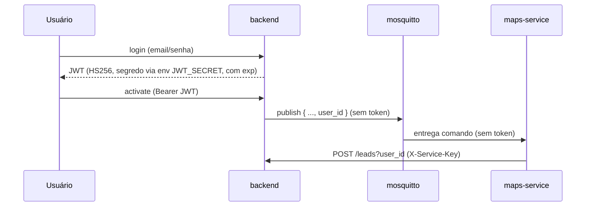

# Arquitetura do Projeto — Prospect Clients

> Documento de referência da arquitetura atual e base para discutir melhorias de
> segurança. Reflete o código no momento da redação; ao alterar fluxos de
> autenticação/mensageria, atualize este arquivo.

## 1. Visão geral

A aplicação coleta *leads* do Google Maps a partir de uma busca e **enfileira** as
mensagens personalizadas no RabbitMQ. O envio propriamente dito não existe mais: a
fila fica retida à espera de um consumidor futuro. É composta por três serviços +
duas peças de infraestrutura de mensageria, orquestrados por `docker-compose.yml`.

| Serviço | Stack | Porta (host) | Responsabilidade |
|---|---|---|---|
| `frontend` | Vue 3 + Vite + nginx | 80 | UI (login, prospecção, leads) |
| `backend` | FastAPI (Python 3.12) | 8000 | API REST, autenticação, persistência, orquestra o scraping via MQTT |
| `maps-service` | Python + Selenium/Firefox | — | Faz o scraping do Google Maps, grava leads na API e enfileira mensagens |
| `mosquitto` | Eclipse Mosquitto (MQTT) | 8883 (TLS) | Bus de comando backend → maps-service |
| `rabbitmq` | RabbitMQ | 5671 (AMQPS) / 15672 | Fila de mensagens produzida pelo maps-service (sem consumidor) |

## 2. Diagrama de componentes

```mermaid
flowchart LR
    User([Usuário / Browser])
    FE[frontend\nVue + nginx :80]
    BE[backend\nFastAPI :8000]
    MQTT{{mosquitto\nMQTTS :8883}}
    MAPS[maps-service\nSelenium/Firefox]
    RMQ{{rabbitmq\nexchange fila_mensagens}}
    DB[(SQLite test.db)]

    User -->|HTTP + JWT| FE
    FE -->|/api/backend/* JWT| BE
    BE --> DB
    BE -->|publish prospect/maps\n(sem token, só user_id)| MQTT
    MQTT -->|subscribe| MAPS
    MAPS -->|POST /leads?user_id, PATCH status\nX-Service-Key| BE
    MAPS -->|publish fila_mensagens| RMQ
    RMQ -.->|queue enviar\n(sem consumidor)| Futuro([Serviço de envio futuro])
```

## 3. Serviços em detalhe

### 3.1 backend (FastAPI)
- **Camadas:** Controller → Service → Repository (SQLAlchemy). DI de services via
  `configurations/dependencies.py::service_provider`.
- **Domínios:** `users`, `operations`, `leads`, `automations`.
- **Persistência:** SQLite (`configurations/database.py`, `sqlite:///./test.db`).
- **Endpoints principais:**
  - `POST /users/`, `POST /users/login`, `GET /users/userme`
  - `GET/POST /leads/`, `GET /leads/categories` (paginação + filtros server-side)
  - `GET/POST /operations/`, `PATCH /operations/{id}/status`
  - `POST /automations/operations/maps/activate`, `PUT /automations/operations/maps/deactivate`
- **Mensageria de saída:** `utils/publisher.py` publica no MQTT (tópico `prospect/maps`).

### 3.2 maps-service (Selenium)
- **Entrada:** consome o tópico MQTT `prospect/maps` (`messaging/mqtt_handler.py`).
- **Execução:** cada operação roda em uma *thread* com um `stop_event`
  (`services/operation_service.py`); o scraping em si fica em `scraper/maps_scraper.py`.
- **Saída:**
  - grava leads chamando `POST /leads/` no backend (`services/lead_service.py`);
  - atualiza status via `PATCH /operations/{id}/status`;
  - publica mensagens no RabbitMQ (`messaging/rabbitmq_publisher.py`).
- **Estado:** operações ativas vivem **em memória** (`_active_operations`); reconciliadas
  no startup do backend (ver `OperationsService.reset_orphaned_operations`).

### 3.3 frontend (Vue)
- Pinia stores (`auth`, `leads`, `operations`).
- Token JWT guardado em `localStorage`; injetado em toda request via interceptor
  (`services/backend.js`). nginx faz proxy de `/api/backend` → backend.

## 4. Fluxos principais

### 4.1 Login
1. `POST /users/login` valida senha (bcrypt) e emite JWT.
2. Front guarda o token e o envia como `Authorization: Bearer` nas próximas chamadas.

### 4.2 Iniciar operação de scraping
1. `POST /automations/operations/maps/activate` cria a operação (status=1) e
   **publica no MQTT** `{status, id_operation, search_text, user_id, message_user}`
   (sem token de usuário).
2. `maps-service` recebe, abre o Firefox, coleta leads.
3. Para cada lote: `POST /leads/?user_id=...` no backend (autenticado com
   `X-Service-Key`) **e** publica mensagens no RabbitMQ.
4. As mensagens ficam na fila `enviar` até que um consumidor seja implementado.

### 4.3 Parar operação
1. `PUT /automations/operations/maps/deactivate` marca status=0 no banco e publica
   MQTT `{status:0, id_operation}`.
2. `maps-service` seta o `stop_event` da thread e encerra o navegador.

## 5. Mensageria

| Bus | Quem publica | Quem consome | Tópico/Exchange | Conteúdo |
|---|---|---|---|---|
| MQTT (mosquitto) | backend | maps-service | tópico `prospect/maps` | comando ativar/desativar (sem token; só `user_id`) |
| RabbitMQ | maps-service | — (nenhum; fila retida) | exchange `fila_mensagens` (direct), routing `enviar` | `{ messages: [{ lead, message }] }` |

## 6. Autenticação e fluxo de credenciais (estado atual)



**Ponto-chave:** usuários e serviços têm credenciais **distintas**. O JWT do usuário
nunca sai do par browser↔backend; o `maps-service` autentica com a sua própria
`SERVICE_API_KEY` (header `X-Service-Key`), validada num esquema separado do JWT.
Comprometer a chave de serviço não compromete usuários, e ela é rotacionável de
forma independente.

## 7. Análise de segurança

| # | Severidade | Achado | Local |
|---|---|---|---|
| S1 | ✅ Resolvida | ~~Segredo do JWT chumbado e fraco~~ → centralizado em `configurations/auth.py`, lido de `JWT_SECRET` (env). **Pendência:** definir um segredo forte (≥32 bytes) em produção | `configurations/auth.py` |
| S2 | ✅ Resolvida | ~~Token de usuário propagado/reutilizado~~ → o token não é mais enviado pelo MQTT; o maps-service usa `SERVICE_API_KEY` (`X-Service-Key`), validada por `require_service`, separada do JWT | `configurations/auth.py`, `utils/security.py`, `automations_service.py`, `lead_service.py` |
| S3 | ✅ Resolvida | ~~MQTT anônimo~~ → `allow_anonymous false` + `password_file` + **TLS (8883)**; clients autenticam com usuário/senha sobre TLS | `mosquitto/mosquitto.conf`, `docker-compose.yml`, `publisher.py`, `mqtt_client.py` |
| S4 | ✅ Resolvida | ~~whatsapp sem autenticação (`/api/send*`) + CORS `*`~~ → o serviço `whatsapp` foi **removido**. A fila permanece; ao implementar o novo consumidor, exigir credencial de serviço e CORS restrito desde o início | (removido) |
| S5 | ✅ Resolvida | ~~JWT sem `exp`~~ → token agora expira (`JWT_EXPIRATION_MINUTES`, default 720). Reduzir para 15–60 min após S2 | `user_service.py`, `configurations/auth.py` |
| S6 | ✅ Resolvida | ~~RabbitMQ `guest/guest`~~ → usuário dedicado via `RABBITMQ_USER`/`RABBITMQ_PASSWORD` (sem guest) | `docker-compose.yml` |
| S7 | ✅ Resolvida (mensageria) | ~~Sem TLS~~ → **TLS no MQTT (8883) e RabbitMQ (5671)** com CA self-signed (`scripts/gen-certs.sh`); clients validam a CA. **Pendência:** TLS no HTTP interno (nginx↔backend, backend↔maps) | `mosquitto.conf`, `rabbitmq/rabbitmq.conf`, `docker-compose.yml`, clients |
| S8 | ✅ Resolvida | ~~`get_current_user` lançava `Exception` genérica + `print`~~ → agora `HTTPException(401)` com `WWW-Authenticate` | `utils/security.py` |
| S9 | 🟡 Média | Token em `localStorage` (exposto a XSS) | `front_end/services/backend.js` |

## 8. A falha central e os caminhos de solução

**Raiz do problema (S2):** o sistema não distingue *autenticação de usuário* de
*autenticação de serviço*. O token do usuário vira credencial de máquina, viaja por
um canal inseguro (S3) e dá ao `maps-service` exatamente os mesmos poderes do usuário,
sem escopo nem revogação independente.

### Caminho recomendado (resolve a raiz)
1. **Parar de propagar o token do usuário.** No comando MQTT, enviar apenas dados não
   sensíveis: `operation_id`, `search_text`, `user_id`. Nenhum segredo no payload.
2. **Dar identidade própria a cada serviço (service accounts).** Cada serviço (hoje o
   `maps-service`, amanhã o consumidor da fila) recebe credenciais exclusivas (API
   key/secret por serviço, via env/secrets manager), validadas pelo backend num esquema
   **separado** do JWT de usuário (ex.: header `X-Service-Key` ou OAuth2 *client credentials*).
3. **Least-privilege:** cada credencial de serviço só pode o necessário (ex.: maps só
   cria leads e atualiza status de operação; nunca ações de usuário). Revogável e
   rotacionável por serviço, sem afetar usuários.

### Evolução (quando precisar de mais rigor)
- **OAuth2 client-credentials** entre serviços, emitindo tokens de curta duração com
  *scopes*; ou **mTLS** (certificado por serviço) para autenticação mútua.

### Higiene de credenciais e canais (independente do acima)
- **S1/S5:** mover `JWT_SECRET` para variável de ambiente/secrets manager (forte e
  único), centralizar num só lugar, adicionar `exp` e validar expiração; considerar
  *refresh tokens*.
- **S3/S6/S7:** desligar `allow_anonymous` no MQTT e exigir usuário+senha+TLS; criar
  usuários dedicados por serviço no RabbitMQ (remover `guest`); habilitar TLS em todos
  os hops; nunca trafegar segredos no corpo das mensagens.
- **S4:** resolvido pela remoção do serviço. O futuro consumidor da fila deve nascer em
  rede interna, sem endpoints públicos; se expuser HTTP, exigir credencial de serviço e
  CORS restrito a origens conhecidas.
- **S8/S9:** `get_current_user` deve lançar `HTTPException(401)` e remover `print`;
  avaliar cookie `httpOnly` em vez de `localStorage` para o token.

## 9. Roadmap sugerido (ordem de impacto × esforço)

1. ✅ **Segredos:** `JWT_SECRET` por env + `exp` no token + corrigir `get_current_user` (S1, S5, S8) — **feito**. Falta definir um segredo forte por ambiente no deploy.
2. ✅ **Identidade de serviço:** API key por serviço (`X-Service-Key`) e parar de propagar o token do usuário (S2) — **feito**. Pendências: chave forte por ambiente no deploy; least-privilege mais fino (escopos por serviço) e proteger também o canal (S3).
3. ✅ **Endurecer brokers:** remover anonymous/guest + auth dedicada + **TLS** em MQTT/AMQP (S3, S6, S7) — **feito**. Pendências: certs reais em produção (hoje self-signed via `scripts/gen-certs.sh`) e TLS no HTTP interno.
4. ✅ **Proteger whatsapp** (S4) — resolvido removendo o serviço. Reavaliar ao
   implementar o novo consumidor da fila `enviar`.
5. **Evolução:** OAuth2 client-credentials/mTLS; migrar SQLite → Postgres para produção.
