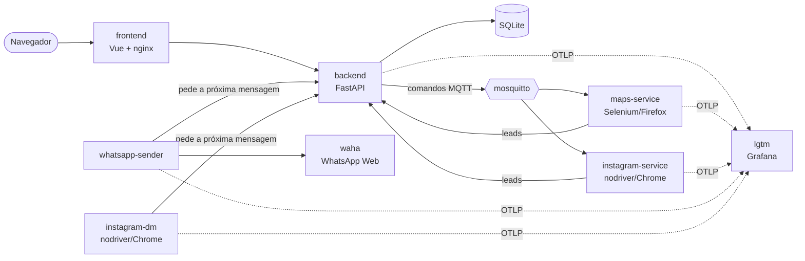

<p align="center">
  
</p>

<p align="center">
  Encontre negócios no Google Maps e perfis no Instagram, organize os leads e
  entre em contato por WhatsApp ou Instagram, no ritmo certo.
</p>

---

## O que é

O **Prospect** automatiza a prospecção de clientes em três etapas:

1. **Busca.** Você digita algo como `restaurantes em Campinas` e o sistema percorre
   o Google Maps (nome, telefone, endereço, site) ou o índice do Google atrás de
   perfis do Instagram.
2. **Leads.** Tudo o que é encontrado vira lead, com filtros por categoria e
   origem, histórico de quem já foi contatado e uma lista de "não contatar".
3. **Campanhas.** Você escreve um modelo de mensagem (`{Olá|Oi} {nome}, tudo bem?`),
   escolhe os leads por seleção ou categoria, e o sistema envia aos poucos: em
   lotes, com intervalos aleatórios, em horário comercial e com limite diário por
   conta, para não parecer spam.

Cada mensagem é gravada no banco antes de sair. Se um serviço cair no meio de um
envio, a mensagem volta para a fila em vez de se perder.

## Arquitetura



| Serviço | Stack | Responsabilidade |
|---|---|---|
| `frontend` | Vue 3, Vite, Tailwind, nginx | Interface: landing, login, prospecção, leads e campanhas |
| `backend` | FastAPI, SQLAlchemy, Alembic | API, autenticação, banco, fila de envio e ritmo das campanhas |
| `maps-service` | Python, Selenium, Firefox | Scraping do Google Maps |
| `instagram-service` | Python, nodriver, Chrome | Busca de perfis do Instagram pelo índice do Google |
| `whatsapp-sender` | Python | Envia as mensagens de WhatsApp das campanhas |
| `instagram-dm` | Python, nodriver, Chrome | Envia as mensagens de Instagram (DM) das campanhas |
| `waha` | WAHA Core | Gateway do WhatsApp Web, usado só pelo `whatsapp-sender` |
| `mosquitto` | Eclipse Mosquitto | Barramento de comandos do backend para as buscas |
| `lgtm` | Grafana, Tempo, Loki, Prometheus, OTel Collector | Observabilidade |

Os workers de envio não decidem quando enviar: eles pedem a próxima mensagem ao
backend, que responde com uma mensagem ou com quanto tempo esperar. Todo o
controle de ritmo fica num lugar só, no banco.

Detalhes de fluxos, autenticação entre serviços e análise de segurança estão em
[`ARCHITECTURE.md`](ARCHITECTURE.md).

## Começando

### Requisitos

- Docker com Docker Compose
- Cerca de 4 GB livres para as imagens (Firefox e Chromium estão nelas)

### 1. Configurar

Crie um `.env` na raiz, ao lado do `docker-compose.yml`. Todas as variáveis têm
um padrão de desenvolvimento, mas segredos devem ser trocados fora da sua
máquina:

```dotenv
# Gere cada segredo com: python -c "import secrets; print(secrets.token_urlsafe(48))"
JWT_SECRET=
SERVICE_API_KEY=
MQTT_PASSWORD=
WAHA_API_KEY=

# Conta usada para enviar DMs. Use uma conta dedicada, nunca a principal:
# automatizar o Instagram vai contra os termos dele e a conta pode ser restringida.
INSTAGRAM_USERNAME=
INSTAGRAM_PASSWORD=

# Portas no host (opcional)
# BACKEND_PORT=8000
# GRAFANA_PORT=3000
```

Os limites de envio (intervalo entre mensagens, tamanho do lote, teto diário,
janela de horário) também são configuráveis. A lista completa está em
[`back_end/.env.example`](back_end/.env.example).

### 2. Subir

```sh
docker compose up -d --build
```

Use `--build` sempre que uma dependência mudar. O código entra nos containers
por volume, mas as bibliotecas ficam na imagem.

| Endereço | O que é |
|---|---|
| http://localhost | Aplicação |
| http://localhost:8000/docs | Documentação interativa da API (Swagger) |
| http://localhost:3000 | Grafana, com o dashboard **Prospect Clients** |
| http://localhost:8025 | Mailpit: os e-mails enviados em desenvolvimento |

### 3. Criar a conta

Abra http://localhost/cadastro, informe e-mail e senha (mínimo de 8 caracteres)
e você já entra na aplicação.

Esqueceu a senha? Use **Esqueci minha senha** no login. O link chega por e-mail,
vale por 30 minutos e funciona uma vez. Em desenvolvimento nenhum e-mail sai de
verdade: todos ficam na caixa de entrada do Mailpit, em http://localhost:8025.
Para enviar de verdade, configure `SMTP_HOST`, `SMTP_PORT`, `SMTP_USERNAME`,
`SMTP_PASSWORD` e `APP_URL` no `.env`.

### 4. Conectar as contas de envio

Na tela **Campanhas**:

- **WhatsApp:** leia o QR code com o celular do número que vai enviar, como no
  WhatsApp Web. A sessão sobrevive a reinícios.
- **Instagram:** o login é feito com a conta do `.env`. Se o Instagram pedir um
  código por e-mail ou SMS, a tela mostra um campo para digitá-lo.

## Observabilidade

Os cinco serviços Python exportam traces, métricas e logs com OpenTelemetry para
o container `lgtm`. Uma busca ou um envio aparece no Grafana como um trace só,
atravessando backend, MQTT, workers e banco. O dashboard **Prospect Clients**
mostra a saúde da API, os resultados das campanhas, os leads encontrados e os
logs, com link direto de cada log para o seu trace.

Guia completo, com a lista de métricas: [`observability/README.md`](observability/README.md).

## Desenvolvimento

### Testes

Cada serviço tem a sua suíte, que roda sem Docker, sem navegador e sem telemetria:

```sh
cd back_end && pytest
cd sender_services/whatsapp_sender && pytest
cd sender_services/instagram_dm && pytest
cd serach_services/maps/maps_service && pytest
cd serach_services/instagram/instagram_service && pytest
```

Cada serviço declara as dependências no próprio `pyproject.toml`. Instale com
`poetry install --no-root` dentro da pasta do serviço, mais o `pytest`.

### Banco e migrations

O schema pertence ao Alembic, e a aplicação nunca cria nem altera tabelas. O
container do backend roda `alembic upgrade head` antes de subir a API. Para criar
uma migration:

```sh
cd back_end
alembic revision --autogenerate -m "descricao curta"
```

Mais em [`back_end/README.md`](back_end/README.md).

### Frontend fora do Docker

```sh
cd front_end
npm install
npm run dev
```

O Vite encaminha `/api/backend` para `http://localhost:8000`, então o backend
precisa estar de pé (pelo compose, por exemplo).

## Estrutura

```
.
├── back_end/                 API FastAPI, migrations e testes
├── front_end/                Aplicação Vue
├── serach_services/
│   ├── maps/maps_service/    Scraping do Google Maps
│   └── instagram/instagram_service/   Busca de perfis do Instagram
├── sender_services/
│   ├── whatsapp_sender/      Envio por WhatsApp (via WAHA)
│   └── instagram_dm/         Envio por DM do Instagram
├── observability/            Dashboard e provisionamento do Grafana
├── docs/                     Imagens da documentação
├── ARCHITECTURE.md           Arquitetura, fluxos e segurança
└── docker-compose.yml
```

Cada serviço tem um README próprio com os detalhes de funcionamento e o que fazer
quando algo quebra.

## Uso responsável

O Prospect coleta apenas informações públicas e envia mensagens só quando você
cria e revisa uma campanha. Respeite a lista de "não contatar", os limites de
envio e a LGPD. Automatizar WhatsApp e Instagram vai contra os termos dessas
plataformas: use números e contas dedicados, e mantenha os limites conservadores
que vêm configurados.
